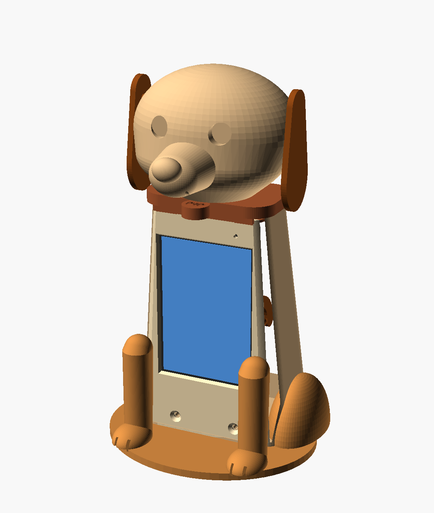
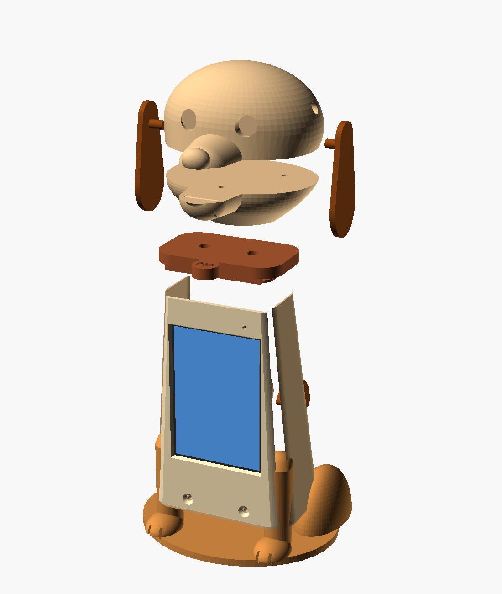

# Pip the dog: a 3D-printable body for the Chatbot Dog

A sitting dog whose **chest is the 3.5" touchscreen** (LCDWIKI ES3C35P). The head, ears, collar
and tail are just for looks. The board, speaker and USB cable live inside the body.

| Assembled | Exploded |
|---|---|
|  |  |

Size: about **11 cm wide × 10 cm deep × 20 cm tall**. Designed in OpenSCAD (`pip_dog.scad`).
Every number is a parameter at the top of the file.

---

## 1. What to print

Everything is in `stl/`, already rotated the way it should lie on the printer bed. **No supports
needed** for any part. All parts fit a small printer (≥ 120 × 125 mm bed, ≥ 125 mm height).

| File | What it is | Print time* | Notes |
|---|---|---|---|
| `body.stl` | the torso (hollow, open front and top) | ~3 h | Prints standing up, floor on the bed |
| `front_plate.stl` | the chest: screen window and mic hole | ~45 min | Outside face on the bed (gives a smooth face) |
| `collar.stl` | lid of the body, with a "PIP" name tag | ~1 h | Flat top on the bed |
| `head_top.stl` | upper half of the head | ~4 h | Flat face on the bed |
| `head_bottom.stl` | lower half of the head and snout | ~2 h | Flat face on the bed |
| `ear_left.stl`, `ear_right.stl` | floppy ears | ~20 min each | Lie flat; the peg points up |
| `base.stl` | base with front legs, paws and haunches | ~4 h | Flat on the bed |
| `tail.stl` | curled tail | ~15 min | Lies flat |
| `neck_peg.stl` | **print 2**: joins the collar and head | ~5 min | Standing up |

\* Rough times at standard quality (0.2 mm layers). Your slicer shows the real time.

**Colours (optional):** light brown or beige for the body and head, dark brown for the ears,
collar and tail, and white or black for the chest plate. One colour works fine too; paint is
optional.

## 2. What to buy

| Item | Qty | Notes |
|---|---|---|
| M3 × **6** mm screws, pan head, **self-tapping for plastic** (or normal M3, see below) | 4 | Hold the board on the chest plate. **Not longer:** an 8 mm screw would poke through the front |
| M3 × 8 mm screws, pan head | 2 | Hold the chest plate to the body |
| M3 × 8 mm countersunk (flat-head) screws | 2 | Base to body, from underneath |
| Googly eyes, **10 mm** | 2 | Glue into the eye sockets |
| **Right-angle (90°) USB-C cable** | 1 | The plug sits under the board, so a straight plug won't fit |
| Super glue (CA) | | Head halves, ears, tail, neck pegs |
| Your ES3C35P board and its speaker | | The speaker pocket is for a **28 mm round** speaker: measure yours, see step 5 |

Normal M3 machine screws also work: they cut their own thread into the plastic. Go in slowly
and don't overtighten.

## 3. Printer settings (beginner defaults)

If you've never printed: these settings work in any slicer (Bambu Studio, PrusaSlicer, Cura,
OrcaSlicer). Start from the slicer's built-in **"0.20 mm Standard"** profile for your printer and
**PLA**, then check:

| Setting | Value | Why |
|---|---|---|
| Material | **PLA** | Easiest to print, no smell, no warping |
| Layer height | 0.2 mm | The standard profile |
| Walls / perimeters | **3** (or more) | Strong screw holes |
| Infill | 15 % | The heads and base are solid shapes; infill keeps them light |
| Supports | **Off** | Not needed; every part was designed for this |
| Brim | **On, 5 mm**, for `body`, `ear_*`, `tail`, `neck_peg` | Helps tall and small parts stay stuck |
| Bed | Clean it with dish soap and water (or isopropyl alcohol) before each print | The #1 reason first prints fail |

**First print:** start with `tail.stl`. It's small and quick, so you can check the printer
works before the 4-hour parts.

**No printer?** Upload the `stl/` files to a print service, such as JLCPCB 3D printing,
Craftcloud or a local makerspace. Choose PLA or PETG with standard quality.

## 4. Test-fit before assembling

1. Lay the **board** face-down into the **front plate**. The glass drops into a shallow pocket,
   the screen shows through the window, and the 4 mounting holes sit on the 4 posts.
2. Drop the **front plate** into the front of the **body**. It sits in a recess, flush with the sides.
3. Put the **collar** on top. Its rim drops into the body, and a small lip holds the top of the chest plate.

If anything is too tight, sand lightly, or set `fit = 0.4` (instead of 0.3) and re-export.

## 5. Assembly

1. **Speaker:** push the speaker into the round pocket on the inside of the back wall (the
   grille side). A dab of hot glue holds it.
   *Measure your speaker first:* if it's not 28 mm round, set `speaker_d` in `pip_dog.scad`
   to its diameter and run `./build.sh` (step 7). Then reprint only `body.stl`.
2. **Board:** screw the board to the front plate's 4 posts with 4 × **M3 × 6** screws, from the
   back of the board.
3. **USB cable:** plug the right-angle USB-C into the board (bottom edge) and lead the cable out
   through the notch at the back of the body floor.
4. **Chest:** slide the front plate (with the board) into the body. Fix the bottom edge with
   2 × M3 × 8 screws into the pillars.
5. **Base:** set the body on the base between the haunches. Screw it on from underneath with
   2 × countersunk M3.
6. **Head:** glue the two head halves together. The 3 small holes line up (a 3 mm piece of
   filament or a toothpick as an alignment pin helps). Glue the 2 **neck pegs** into the
   bottom of the head, then plug the head into the **collar**. Glue it, or leave it loose to
   take it off.
7. **Ears and tail:** push the ear pegs into the holes on the sides of the head, and the tail
   peg into the back. Glue them if they're loose.
8. **Eyes:** glue googly eyes into the eye sockets.
9. Put the collar and head on top. **To open Pip later,** lift off the head and collar together.

## 6. Where everything is

| On the board | On the dog |
|---|---|
| Screen and touch | Window in the chest (bevelled edge for comfortable tapping) |
| Microphone (top right of the front) | Small hole in the chest plate, top right |
| Speaker (cable to the side connector) | Grille on the dog's back |
| USB-C (bottom edge) | Cable exits through the back of the floor |
| RESET / BOOT buttons | Inside; you rarely need them. Remove the chest plate to reach them |

## 7. Changing the design

Install OpenSCAD (`brew install --cask openscad@snapshot`), open `pip_dog.scad`, and change the
parameters at the top:

- `speaker_d`: your speaker's diameter
- `fit`: looser or tighter fits
- `head_w`, `snout_len`, `ear_len`, …: the dog's look
- `usb_room`: room under the board for the USB plug

Then regenerate all files and previews:

```bash
./build.sh
```

To view one part: `openscad -D 'part="head_top"' pip_dog.scad`. Parts: `assembly`, `exploded`,
`front_plate`, `body`, `collar`, `head_top`, `head_bottom`, `ear_left`, `ear_right`, `base`,
`tail`, `neck_peg`.

## Credits and references

- Board dimensions come from the vendor's drawing: `reference/ES3C35P_size.pdf` (LCDWIKI / QDtech).
- Inspired by Espressif's open-source [ESP-VoCat rotating base](https://oshwhub.com/esp-college/esp-echoear-base).
  This design is new, not derived from their files. A rotating base (28BYJ-48 stepper) could be
  added under the base later.
